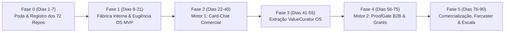

# 🗺️ ROADMAP-90-DAYS — Plano de Execução em Seis Fases (90 Dias)

> **Objetivo dos 90 Dias:** Não é "terminar todos os 72 repositórios", mas encerrar o ciclo de 90 dias com uma **operação comercial funcional**, **um primeiro produto validado com clientes reais (`card-chat`)**, **um ativo Web3 empacotado (`ProofGate`)** e a **infraestrutura reutilizável (`Eugência OS` / `ValueCurator OS`)** em plena operação.

---

## Visão Geral do Sequenciamento

---

## Fase 0 — Poda e Organização do Portfólio (Dias 1–7)

- **Objetivo:** Transformar os 72 repositórios (`59 compilatorum` + `13 smp-sandramariapereira`) em um portfólio administrável sob a regra $WIP_{\text{comercial}} \le 2$.
- **Entregáveis:**
  - [x] Inventário completo automatizado (`data/portfolio_assets.json` e `PORTFOLIO-ASSETS-REGISTER.md`).
  - [x] Classificação econômica A–F de todos os 72 ativos.
  - [x] Mapeamento de dependências, duplicidades e governança jurídica dos repositórios compartilhados.
  - [x] Definição formal dos 2 produtos em WIP ativo (`card-chat` e `value-curator`/ProofGate) e estacionamento explícito dos projetos P3.
- **Critério Objetivo de Conclusão:** Sabemos exatamente quais ativos serão trabalhados agora e quais permanecerão estacionados sem consumir atenção operacional. (**Status: ✅ CONCLUÍDO**)

---

## Fase 1 — Construção da Fábrica Interna e Eugência OS Mínimo (Dias 8–21)

- **Objetivo:** Estabelecer a infraestrutura de produção da Eugência e o cockpit híbrido (Web App + Cytoscape.js + Emacs Org-mode) para que a própria transição profissional opere sem atrito.
- **Entregáveis:**
  - [x] **Eugência OS Cockpit Híbrido:** Backend FastAPI + SQLite/Postgres + Frontend React/Cytoscape.js + Sincronização bidirecional Emacs Org-mode (`org/*.org` e `emacs/eugencia-os.el`).
  - [x] **AI Gateway Inicial:** Roteador formal de modelos ($M^*$) com cálculo de créditos e limites de consumo.
  - [x] **ProofGate Core:** Pipeline determinístico $\text{Intent} \rightarrow \text{Policy} \rightarrow \text{Validation} \rightarrow \text{Approval} \rightarrow \text{Execution} \rightarrow \text{Receipt}$.
  - [x] **Flow Inbox & Opportunity Intelligence:** Captura universal sem interrupção de flow e CRM de oportunidades (Superteam, Gitcoin, Dework/GitHub).
  - [ ] Reprodução em ambiente limpo dos +131 testes do `harness-engineering` e padronização de template de microsserviço.
- **Critério Objetivo de Conclusão:** Conseguimos iniciar e operar um serviço utilizando o AI Gateway, o ProofGate e o cockpit híbrido sem reconstruir infraestrutura do zero.

---

## Fase 2 — Primeiro Produto Comercial: Card-Chat / AI Commerce Agent (Dias 22–40)

- **Objetivo:** Colocar o `card-chat` em operação comercial real como **AI Commerce Agent** (1º vertical: lojas de cartas colecionáveis e TCG — Vespa TCG).
- **Prioridades Técnicas e Comerciais:**
  1. Resolver de forma definitiva a divergência arquitetural: manter o serviço Node.js/TypeScript para mensageria WhatsApp e conectá-lo via API ao ValueCurator OS (Python/FastAPI).
  2. Consolidar o fluxo comercial: $\text{WhatsApp} \rightarrow \text{Agent} \rightarrow \text{Catalog} \rightarrow \text{Recommendation} \rightarrow \text{Checkout (MercadoPago)} \rightarrow \text{HumanHandoff}$.
  3. Ativar a política `card-chat` no ProofGate: proibir invenção de estoque, preços fora da tabela ou descontos $> 10\%$ sem aprovação humana.
  4. Publicar Landing Page enxuta, vídeo de demonstração e pacote comercial **AI Commerce Starter** (Setup R$ 1.500–3.000 + R$ 400–800/mês).
- **Critério Objetivo de Conclusão:** Pelo menos 1 cliente real (piloto pago ou contrato inicial) utiliza o produto em operação comercial real e medimos $L$, $\rho$ e $MC$ no painel.

---

## Fase 3 — Infraestrutura Empresarial Compartilhada: ValueCurator OS (Dias 41–55)

- **Objetivo:** Extrair da operação real do `card-chat` os componentes reutilizáveis ($\Delta A_t > 0$) para consolidar as 7 camadas do **ValueCurator OS**.
- **Entregáveis:**
  - Multi-tenancy completo (`Organization`, `Workspace`, `User`, `Subscription`, `Usage`).
  - Bilhetagem automatizada por créditos normalizados (planos Starter 500, Pro 2.000, Business 10.000).
  - *Agent Registry* e *Workflow Registry* com controle de promoção de autonomia (L0 $\rightarrow$ L4).
  - Telemetria consolidada no painel **Portfolio OS**.
- **Critério Objetivo de Conclusão:** O `card-chat` opera como o primeiro consumidor formal multi-tenant do ValueCurator OS.

---

## Fase 4 — ProofGate como Produto B2B e Objeto de Grant Web3 (Dias 56–75)

- **Objetivo:** Empacotar o **ProofGate-as-a-Service** como oferta comercial de *AI Agent Assurance* e submeter os Work Packages abertos (WP1–WP3) a Grants.
- **Entregáveis:**
  1. SDK TypeScript documentado (`WP1 — Open Public Goods`).
  2. Suíte de testes adversariais reproduzíveis (`WP2 — Research & Validation`).
  3. Adaptadores Solana Devnet/Mainnet em modo `APPROVAL_ONLY` com Pyth e Jupiter (`WP3 — Shared Infrastructure`).
  4. API Hospedada de validação + Dashboard de auditoria de eventos e recibos criptográficos (`WP4` e `WP5 — Commercial Product`).
  5. Relatório técnico de segurança e modelo de licenciamento B2B.
- **Critério Objetivo de Conclusão:** Um desenvolvedor externo consegue integrar o SDK do ProofGate a um agente autônomo em menos de 30 minutos e reproduzir a bateria de testes adversariais.

---

## Fase 5 — Comercialização, Build in Public e Capitalização (Dias 76–90)

- **Objetivo:** Converter as evidências acumuladas nas Fases 1–4 em canais recorrentes de aquisição de clientes B2B e financiamento não-dilutivo.
- **Ações:**
  - Publicar estudo de caso verificável do **AI Commerce Agent** e benchmark técnico do **ProofGate**.
  - Operar o ritmo sustentável de comunicação no **Reputation & Publishing OS**: 1 radar/relatório semanal às segundas-feiras + publicações extraordinárias no Farcaster e GitHub baseadas exclusivamente em evidências reais.
  - Submeter propostas de Grant qualificadas no **Superteam Earn** (Solana) e **Gitcoin Grants**.
  - Prospectar ativamente para atingir o **Estágio 1 de Validação Comercial** (3 clientes pagantes recorrentes, MRR $\ge \text{R\$ } 1.500$).
- **Critério Objetivo de Conclusão:** Temos evidências auditáveis de utilização, oferta comercial ativa, pelo menos 1 submissão de grant estruturada e funil de aquisição B2B em andamento.
